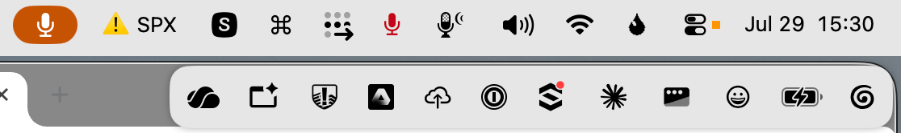
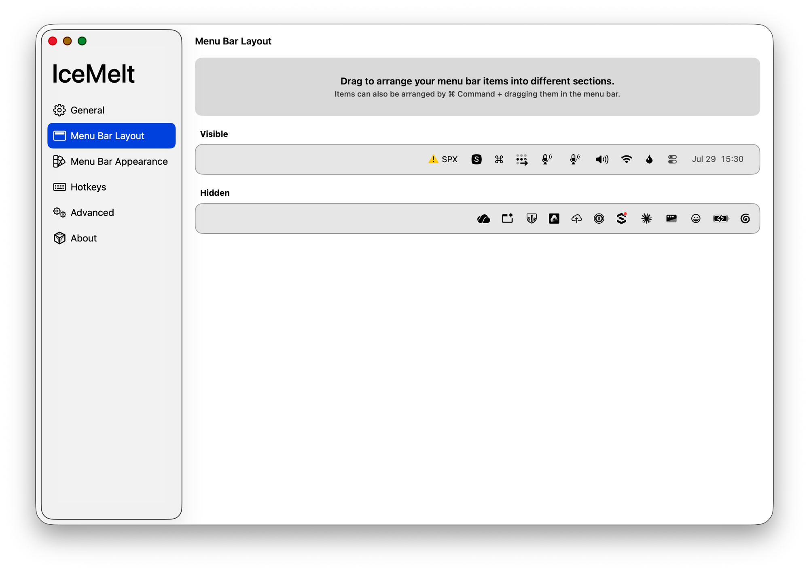
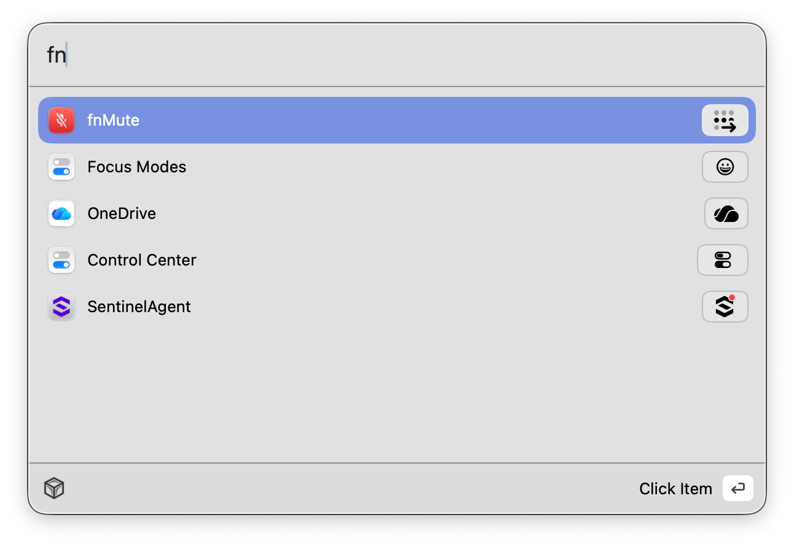
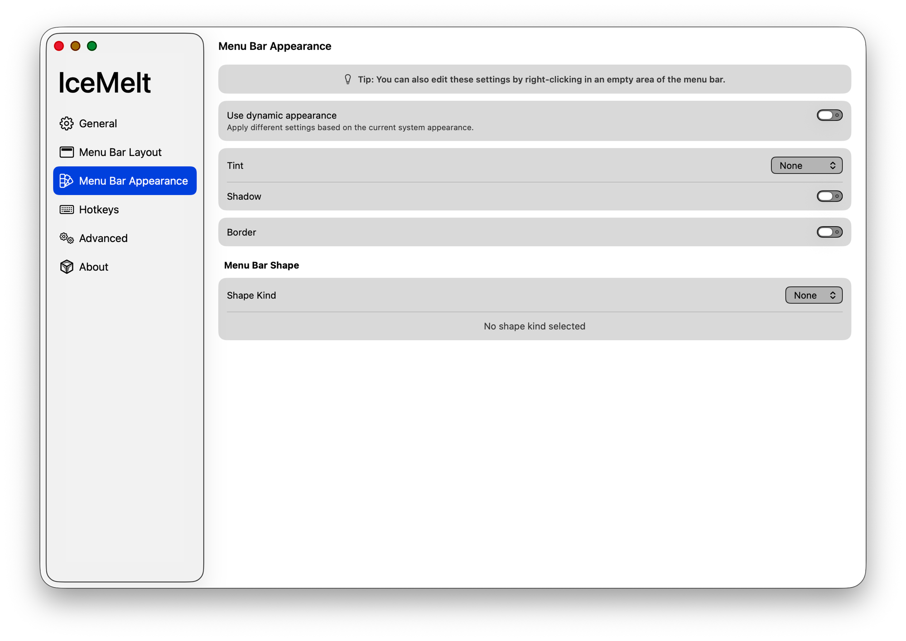
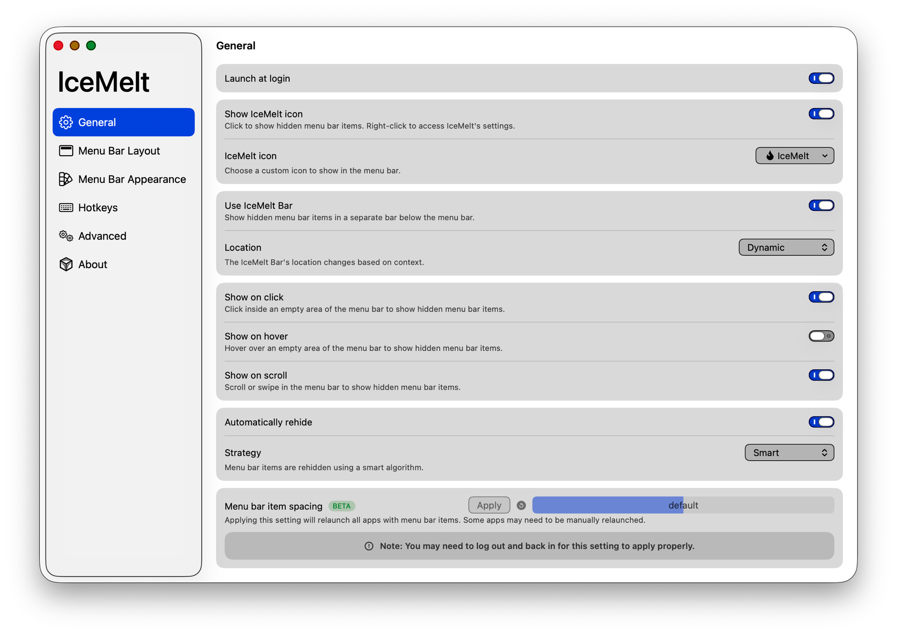

<div align="center">
    
    <h1>IceMelt 26</h1>
</div>

IceMelt is a menu bar management tool for macOS. Its primary function is hiding and showing menu bar items, alongside a range of additional features that make it one of the most versatile menu bar tools available.

IceMelt is a fork of [Ice](https://github.com/jordanbaird/Ice) by Jordan Baird, maintained by [Scratch Itch Software](https://scratchitchsoftware.com/icemelt). It delivered a stable build for **macOS 26 (Tahoe)** — see [What IceMelt changes](#what-icemelt-changes) below.

[](https://github.com/pnikolaidis/icemelt/releases/latest)


[](https://scratchitchsoftware.com/icemelt)
[](LICENSE)

> [!IMPORTANT]
> **IceMelt 26 is complete and no longer maintained.** IceMelt set out to make Ice work on macOS 26 (Tahoe), and it does. macOS 27's rebuilt menu bar now covers basic icon hiding on its own (⌘-drag to reorder, then let the « collapse the rest), so the project has ended.
>
> - **On macOS 26:** the [final release](https://github.com/pnikolaidis/icemelt/releases/latest) keeps working. No further updates are planned.
> - **On macOS 27:** the final release runs as-is (it includes the [macOS 27 fixes](https://github.com/pnikolaidis/icemelt/discussions/57)), but it gets no further fixes. Try the built-in menu bar features first. See [macOS 27: what changed](#macos-27-what-changed-and-what-icemelt-still-adds).
> - **Looking for an active project?** See [upstream Ice](https://github.com/jordanbaird/Ice).
>
> This repository is archived: issues and pull requests are closed, and releases stay available.

## Install

Download the `IceMelt-<version>.dmg` file from the [latest release](https://github.com/pnikolaidis/icemelt/releases/latest) and drag `IceMelt.app` into your `Applications` folder.

Releases are signed with a Developer ID certificate (Paradigm Consulting Company) and notarized by Apple, so they open without a Gatekeeper override.

There is no Homebrew cask for IceMelt yet. Note that `brew install --cask jordanbaird-ice` installs **upstream Ice**, not IceMelt.

### Requirements

macOS 26 (Tahoe) or later. See [Why does IceMelt only support macOS 26 and later?](#why-does-icemelt-only-support-macos-26-and-later)

### Updates

IceMelt checks its own signed update feed (`https://pnikolaidis.github.io/icemelt/appcast.xml`) via Sparkle. New versions are offered in-app; automatic checking and downloading are configurable in `Settings → About`.

## Build from source

Requires Xcode 26 or later.

```sh
git clone https://github.com/pnikolaidis/icemelt.git
cd icemelt
xcodebuild -project IceMelt.xcodeproj -scheme IceMelt -configuration Release build
```

Unsigned local builds are fine for development. Distributable builds are signed with a Developer ID certificate and notarized.

## What IceMelt changes

Relative to upstream Ice (0.11.x and the unreleased `macos-26` branch):

- **Tahoe-correct item identification.** Menu bar items are resolved through Accessibility (an `AXExtrasMenuBar` walk correlated with window IDs) instead of window ownership, which macOS 26 assigns wholesale to Control Center. Items show their real names and icons, and keep their sections across app relaunches.
- **No hard Screen Recording gate.** When capture is unavailable, the layout and search UIs fall back to app-derived icons and names instead of showing an empty pane.
- **IceMelt Bar fixes** for visibility and crashes on Tahoe, including correct backgrounds on external displays.
- **Its own identity and update channel** — bundle ID `com.pnikolaidis.icemelt`, an IceMelt droplet menu bar icon, and a self-hosted Sparkle appcast signed with our own key.

Phase-by-phase plans live in [`PLAN.md`](PLAN.md); the current snapshot is in [`docs/STATUS.md`](docs/STATUS.md).

## macOS 27: what changed, and what IceMelt still adds

macOS 27 rebuilt the menu bar, and that changes how IceMelt works.

**What macOS 27 does on its own**

- One system process, MenuBarAgent, now draws every menu bar icon. Icons are no longer separate windows, so no app (IceMelt included) can move them off-screen anymore.
- macOS has its own **«** button. When icons don't fit, it moves the leftmost ones into an overflow behind the «. Clicking « shows them on the left side of the menu bar.
- You can ⌘-drag icons to reorder them, so the ones you care least about end up on the left and overflow first.
- There is no setting for the «. It appears whenever icons don't fit, even with IceMelt quit, and IceMelt can't remove or restyle it.

**How IceMelt hides icons on macOS 27**

1. It places an invisible divider left of your visible icons.
2. It widens that divider (with blank spacers on large displays) until the bar has no room left.
3. macOS then pushes everything left of the divider, your hidden icons, into its overflow.

The « you see is always macOS's own. IceMelt drives it from the outside, with clicks and ⌘-drags, which is why it sometimes moves the pointer or briefly rearranges the bar.

**Pros and cons**

| | macOS 27 alone | With IceMelt |
|---|---|---|
| Hide icons on a MacBook (notch) | Yes, if there are more icons than fit. Leftmost overflow first | Yes. You pick which icons hide |
| Hide icons on a large display | No. Everything fits, so nothing overflows | Yes |
| Hide icons with only a few running | No | Yes |
| Always-hidden section | No | Yes |
| Where hidden icons appear | Far left of the menu bar | Far left too (macOS decides, [#52](https://github.com/pnikolaidis/icemelt/issues/52)), or in the IceMelt Bar below the menu bar |
| Show on hover, click, scroll or notch click; auto-rehide; hotkeys; search | No | Yes |
| Menu bar tint, shadow, border and shapes | No | Yes |
| Moves your pointer or rearranges the bar | No | Sometimes, while moving icons or placing spacers (it asks first) |

**In short:** on a MacBook with many menu bar icons, macOS 27 now covers basic hiding by itself: reorder with ⌘-drag and let the « do the rest. IceMelt is still worth it if you use a large display, want an always-hidden section, want hidden icons below the menu bar instead of at the far left, or use its hover, hotkey, search or appearance features.

## Features

### Menu bar item management

- Hide menu bar items
- "Always-hidden" menu bar section
- Show hidden menu bar items when hovering over the menu bar
- Show hidden menu bar items when an empty area in the menu bar is clicked
- Show hidden menu bar items by scrolling or swiping in the menu bar
- Automatically rehide menu bar items
- Hide application menus when they overlap with shown menu bar items
- Drag and drop interface to arrange individual menu bar items
- Display hidden menu bar items in a separate bar (e.g. for MacBooks with the notch)
- Search menu bar items
- Menu bar item spacing (BETA)

### Menu bar appearance

- Menu bar tint (solid and gradient)
- Menu bar shadow
- Menu bar border
- Custom menu bar shapes (rounded and/or split)
- Different settings for light/dark mode ("dynamic appearance")

### Hotkeys

- Toggle individual menu bar sections
- Show the search panel
- Enable/disable the IceMelt Bar
- Show/hide section divider icons
- Toggle application menus

### Other

- Launch at login
- Automatic updates
- Usable without Screen Recording permission (degraded item previews)

## Why does IceMelt only support macOS 26 and later?

IceMelt is built on the Tahoe adaptation of Ice, which reworks menu bar geometry, event handling, and item identification around behavior specific to macOS 26. Supporting macOS 14 and 15 would mean maintaining a large, untested compatibility matrix in exactly the code that is hardest to get right.

If you are on macOS 14 or 15, [upstream Ice 0.11.x](https://github.com/jordanbaird/Ice/releases) works well there.

## Gallery

#### Show hidden menu bar items below the menu bar

The IceMelt Bar holds everything from the hidden section, so the menu bar itself stays short.



#### Drag-and-drop interface to arrange menu bar items



#### Search menu bar items

Fuzzy search across every item, visible or hidden; Enter clicks the match.



#### Customize the menu bar's appearance

Tint, shadow, border, and custom menu bar shapes, with separate settings for light and dark mode.



#### Settings



## Contributing

IceMelt 26 is no longer maintained and does not accept issues or pull requests. Please don't file IceMelt problems on upstream Ice. Known issues remain documented in [FREQUENT_ISSUES.md](FREQUENT_ISSUES.md).

The source stays available under the GPL; forks are welcome. Development happened on the `melt` branch.

## License

IceMelt is available under the [GPL-3.0 license](LICENSE), the same license as upstream Ice.

Copyright © 2026 Scratch Itch Software. Based on [Ice](https://github.com/jordanbaird/Ice), © 2023–2025 Jordan Baird. If IceMelt is useful to you, consider [supporting Jordan Baird](https://github.com/sponsors/jordanbaird), whose work it is built on.
